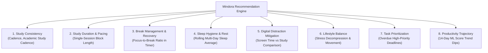

# MINDORA — PHASE 4.1 TECHNICAL DESIGN REPORT
## Personalized Productivity Recommendation Engine: Architecture, Rule Specifications & Technical Design

**Document ID:** `MINDORA-PHASE-4-1-DESIGN`  
**Version:** 1.2.0 (Final Architecture Validation & Implementation Readiness Gate)  
**Authors:** Principal Software Architect, Senior Golang Backend Engineer, PostgreSQL Database Architect, Applied Data Scientist  
**Target Subsystems:** Backend Recommendation Pipeline, Data Aggregation Layer, Database Schema, Frontend UX  
**Status:** VALIDATED TECHNICAL DESIGN — READY WITH CONDITIONS  
**Last Updated:** November 20, 2026  

---

## Document Revision History

| Version | Date | Author(s) | Summary of Changes |
|---|---|---|---|
| **1.0.0** | 2026-11-20 | Senior Software Architect, Senior Backend Engineer, Senior React Engineer, ML Engineer | Initial draft proposal for Phase 4.1 Recommendation Engine. |
| **1.1.0** | 2026-11-20 | Senior Software Architect, Golang Backend Engineer, Database Engineer, Applied Data Scientist | **Technical Review & Architecture Correction:**<br>1. Audited all 9 rules; removed medical/neuroscience claims.<br>2. Decoupled `study_sessions` from `focus_sessions`.<br>3. Introduced partial unique index idempotency (`uq_recommendations_user_rule_pending`).<br>4. Re-architected lifecycle into on-demand execution with 5-minute throttle.<br>5. Decoupled personalization tiers from confounding account age with lifestyle count.<br>6. Specified daily aggregation and baseline filtering for Rule 8.<br>7. Added codebase verification classifications (`CONFIRMED`, `PROPOSED`, `WARNING`). |
| **1.2.0** | 2026-11-20 | Principal Software Architect, Senior Golang Backend Engineer, PostgreSQL Database Architect, Applied Data Scientist | **Final Architecture Validation & Implementation Gate:**<br>1. **Rule 1 Separation:** Established completed `study_sessions` as the strict primary metric for academic study consistency; focus sessions restricted to supplementary context.<br>2. **Evaluation Identity & Idempotency:** Added `evaluation_period_start`, `evaluation_period_end`, and `evaluation_key` to schema and GORM model; reconciled PostgreSQL `ON CONFLICT` semantics with partial index and period reappearance.<br>3. **Cache & Invalidation Policy:** Replaced naive time-based throttle with mutation-driven invalidation; specified real-time query verification for tasks.<br>4. **Rule 8 Five-Layer Provenance:** Formulated strict 5-layer verification for fully personalized predictions, daily aggregation formula, and explicit separation of model trajectory from student ability.<br>5. **Deterministic Tier Waterfall:** Formulated MECE priority waterfall and validated across all 7 edge scenarios (including dormant accounts and study-only users).<br>6. **API Retrieval vs. Evaluation:** Split `GET /recommendations` into default read-only retrieval and explicit `evaluate=true` trigger to protect dashboard performance.<br>7. **Final Validation Matrix & Gate Decision:** Produced comprehensive validation matrix across all subsystems; classified final status as `READY WITH CONDITIONS`. |

---

## 1. Executive Summary & Preserved Architectural Decisions

Mindora has successfully operationalized Phase 2 (Core Productivity Tracking) and Phase 3 (Productivity Analytics & Ridge Regression Model Inference). The backend tracks study sessions, focus intervals, daily lifestyle habits, and academic tasks, calculating objective analytics and generating daily Ridge Regression productivity estimates (`mindora-productivity-ridge-v1.0.0`).

The **Personalized Productivity Recommendation Engine (Phase 4.1)** transforms Mindora from a retrospective tracking application into an active, intelligent productivity partner. It evaluates verified user activity against deterministic, evidence-based heuristics to deliver targeted, actionable guidance.

### 1.1 Preserved Architectural Decisions

In strict accordance with Mindora's engineering governance, the following foundational architectural decisions are preserved:

1. **Deterministic Rule-Based Engine Over Opaque Heuristics:** In academic and lifestyle interventions, opaque black-box recommendations degrade trust. The engine operates on deterministic, auditable rules where every recommendation exposes its underlying trigger conditions, observed data sources, derived metrics, and reference thresholds.
2. **Frozen Machine Learning Model (`mindora-productivity-ridge-v1.0.0`):** The existing Ridge regression model remains strictly frozen. The recommendation engine consumes prediction metadata (e.g., `is_baseline`, `predicted_score`, `unrecorded_features`) as contextual signals, but does not modify weights, coefficients, or StandardScaler parameters.
3. **Strict Four-State Data Semantics:** The system rigorously distinguishes:
   - **Observed Positive:** Measured values $> 0$.
   - **Observed Zero:** Measured values explicitly recorded as $0$ (e.g., zero minutes of exercise).
   - **Missing / Unrecorded:** SQL `NULL` representing absence of data. **Never interpreted as zero.**
   - **Imputed:** Values substituted solely for ML inference. **Never presented as user behavior.**
4. **Strict Exclusion of Non-Existent Features:**
   - **No Mood Tracker:** Mindora has no mood logging table or UI. Only the numeric `stress_level` (1–10) in `lifestyle_records` is supported.
   - **No `attendance_percentage`:** Excluded from models, database, and recommendation rules.
   - **No `focus_score`:** Mindora records interval minutes and interruptions; it does not compute a synthetic "focus score".
   - **No `final_grade`:** Excluded due to target leakage and lack of academic grading authority.
5. **Strict User Ownership & IDOR Protection:** All recommendation streams, evaluations, and mutations are scoped strictly to the authenticated `user_id`. Cross-user access attempts return `404 Not Found`.
6. **Administrative Isolation:** Administrators have zero access to individual student recommendation streams, study sessions, focus intervals, or lifestyle habits.
7. **Cognitive Load Cap (Maximum 3 Active Recommendations):** To prevent alert fatigue, the active recommendation stream is capped at a maximum of 3 concurrent recommendations, ranked by priority (`critical` > `high` > `medium` > `low`).
8. **Dedicated Recommendations Hub (`/recommendations`):** Replaces the current `PlaceholderModulePage` route with a comprehensive recommendation management page featuring filter tabs, expandable evidence disclosures, and action handlers.
9. **Dashboard Integration via Existing Components:** Surfaces top urgent recommendations on `/dashboard` by integrating with `AIAssistantWidget.tsx` and `UserHeroBanner.tsx`.
10. **Zero Scope Creep:** No unrelated Mindora modules are modified or redesigned.
11. **Design-Only Governance:** No application code, database migrations, or ML artifacts are altered during this technical design validation.

---

## 2. Codebase Verification & System Architecture Audit

Inspection of `refs/heads/backend` and `refs/heads/frontend` confirms the following architecture:

### 2.1 Backend Technology Stack
- **Language / Runtime:** Golang 1.24+
- **HTTP Web Framework:** Fiber v2 (`github.com/gofiber/fiber/v2`)
- **Object-Relational Mapping:** GORM v1.25+ (`gorm.io/gorm`)
- **Database Engine:** PostgreSQL 18
- **Authentication & RBAC:** Stateful JWT with refresh token rotation, `middleware.JWTAuthMiddleware`, `middleware.RequireRole`, `middleware.RequireOwnership`.

### 2.2 Layering Architecture
```
[HTTP Client / Frontend React App]
       │
       ▼
[Fiber Middleware] (CORS, Rate Limiter, JWTAuthMiddleware, RequireRole)
       │
       ▼
[Recommendation Handler] (internal/handlers/recommendation_handler.go)
       │
       ▼
[Recommendation Service] (internal/services/recommendation_service.go)
       ├── Evaluates 9 Deterministic Rule Engines
       ├── Resolves Personalization Tier (Tiers 1–4 Waterfall)
       ├── Mutation-Aware Invalidation Check (Watermark / Invalidation Policy)
       └── Enforces 48-Hour Dismissal Cooldown & Period Identity
       │
       ▼
[Repositories Layer] (internal/repositories)
       ├── RecommendationRepository (internal/repositories/recommendation_repository.go)
       ├── StudyRepository (internal/repositories/study_repository.go)
       ├── FocusRepository (internal/repositories/focus_repository.go)
       ├── LifestyleRepository (internal/repositories/lifestyle_repository.go)
       ├── TaskRepository (internal/repositories/task_repository.go)
       └── PredictionRepository (internal/repositories/prediction_repository.go)
       │
       ▼
[PostgreSQL 18 Database] (tables: recommendations, tasks, study_sessions, focus_sessions, lifestyle_records, productivity_predictions)
```

---

## 3. Existing Frontend Architecture Audit

Inspection of `refs/heads/frontend` confirms the following structure:

### 3.1 Technology Stack
- **Core Library:** React 19 (`react`, `react-dom`)
- **Routing:** React Router DOM v7 (`react-router-dom`)
- **Build Tool:** Vite 8 (`vite`, `@vitejs/plugin-react`)
- **Type System:** TypeScript ~7.0
- **CSS Framework:** Tailwind CSS 3.4
- **Linter:** Oxlint 1.89+

### 3.2 Navigation & Routing Structure (`App.tsx` & `Sidebar.tsx`)
1. **`/dashboard` (`UserDashboardPage.tsx`):** Displays User Hero Banner, KPI metrics, `AIAssistantWidget.tsx`, Active Tasks card, and ML Productivity Estimate card (`Ridge v1.0.0`).
2. **`/analytics` (`AnalyticsPage.tsx`):** Period selector (`daily`, `weekly`, `monthly`), statistical KPI rows, ML Prediction Card with cold-start disclosure callout, and 5-item historical prediction table.
3. **`/recommendations` (`PlaceholderModulePage.tsx`):** Currently registered in `App.tsx` as a guarded placeholder route:
   ```tsx
   <Route path="/recommendations" element={<ProtectedRoute allowedRoles={['user', 'admin']}><PlaceholderModulePage /></ProtectedRoute>} />
   ```
   Present in `Sidebar.tsx` under `userInsightsNavItems` with icon `<SparklesIcon />` and tag `'Phase 4'`.

---

## 4. Available Data Source Inventory & Codebase Audit Classifications

Findings are classified as:
- **`CONFIRMED`:** Verified directly in Go source code and database migrations.
- **`PROPOSED`:** New schema or component introduced for Phase 4.1.
- **`WARNING`:** Critical semantic difference or potential trap identified during code inspection.
- **`NOT VERIFIED`:** Unverified against source code.

| Domain | Table | GORM Model | Key Attributes & Nullability | Repository Query Methods | Verification Status | Architectural Analysis & Warnings |
|---|---|---|---|---|:---:|---|
| **Tasks** | `tasks` | `models.Task` | `id` (UUID), `user_id` (UUID), `title` (string), `category` (string, default `'Study'`), `priority` (`'low'`, `'medium'`, `'high'`), `status` (`'pending'`, `'in_progress'`, `'completed'`, `'cancelled'`), `deadline` (`*time.Time`), `completed_at` (`*time.Time`), `deleted_at` (`gorm.DeletedAt`) | `taskRepo.FindAll(filter)`<br>`taskRepo.CountByStatus(userID)`<br>`taskRepo.CountCompletedByDateRange(start, end)` | **CONFIRMED** | Soft-deleted tasks (`deleted_at IS NOT NULL`) are automatically excluded by GORM. Deadlines are nullable. Priority check constraint confirms exactly `'low'`, `'medium'`, `'high'`. |
| **Study Sessions** | `study_sessions` | `models.StudySession` | `id` (UUID), `user_id` (UUID), `task_id` (`*uuid.UUID`), `subject` (string), `duration_seconds` (int), `status` (`'active'`, `'paused'`, `'completed'`, `'cancelled'`), `started_at` (`time.Time`), `ended_at` (`*time.Time`) | `studyRepo.GetDailyStatistics(start, end)`<br>`studyRepo.FindCompletedSessions(start, end)`<br>`studyRepo.GetCompletedDuration(start, end)` | **CONFIRMED**<br>**WARNING** | **WARNING:** Tracks continuous academic study blocks. `duration_seconds` accumulates actual active study time. Status includes `'paused'`. It is completely decoupled from Pomodoro focus timer intervals. |
| **Focus Sessions** | `focus_sessions` | `models.FocusSession` | `id` (UUID), `user_id` (UUID), `task_id` (`*uuid.UUID`), `session_type` (`'focus'` vs `'break'`), `duration_minutes` (int), `status` (`'active'`, `'completed'`, `'abandoned'`), `interruption_count` (int), `started_at` (`time.Time`), `ended_at` (`*time.Time`) | `focusRepo.GetDailyStatistics(start, end)`<br>`focusRepo.CountCompletedBreaks(start, end)`<br>`focusRepo.GetCompletedFocusDuration(start, end)`<br>`focusRepo.FindCompletedIntervals(start, end)` | **CONFIRMED**<br>**WARNING** | **WARNING:** One row represents exactly ONE Pomodoro interval. Check constraint allows ONLY `status IN ('active', 'completed', 'abandoned')`. **There is NO `'paused'` status in `focus_sessions`.** Incomplete/abandoned intervals have `status = 'abandoned'`. |
| **Lifestyle Records** | `lifestyle_records` | `models.LifestyleRecord` | `id` (UUID), `user_id` (UUID), `record_date` (`DATE`), `sleep_hours` (`*float64`), `phone_usage_hours` (`*float64`), `social_media_hours` (`*float64`), `youtube_hours` (`*float64`), `gaming_hours` (`*float64`), `coffee_intake_mg` (`*int`), `exercise_minutes` (`*int`), `stress_level` (`*int`, 1–10), `deleted_at` (`gorm.DeletedAt`) | `lifestyleRepo.FindByDate(userID, date)`<br>`lifestyleRepo.FindByDateRange(userID, start, end)`<br>`lifestyleRepo.FindHistory(userID, limit, offset)` | **CONFIRMED** | Unique constraint `uq_lifestyle_records_user_date` guarantees at most one record per user per calendar date. All behavioral metrics are nullable (`NULL` = unrecorded). |
| **ML Predictions** | `productivity_predictions` | `models.ProductivityPrediction` | `id` (UUID), `user_id` (UUID), `predicted_score` (numeric(5,2)), `model_version` (string), `study_hours` (numeric(4,2)), `sleep_hours` (`*float64`), `phone_usage_hours` (`*float64`), `stress_level` (`*int`), `features_snapshot` (jsonb), `prediction_date` (`DATE`), `created_at` (`TIMESTAMPTZ`) | `predictionRepo.FindLatest(userID)`<br>`predictionRepo.FindByDate(userID, date)`<br>`predictionRepo.FindHistory(userID, limit, offset)` | **CONFIRMED**<br>**WARNING** | **WARNING:** No unique constraint exists on `(user_id, prediction_date)`. A user can trigger multiple predictions on the same calendar date. Historical queries must aggregate by taking the latest prediction per calendar date. Virtual fields (`IsBaseline`, `UnrecordedFeatures`, `PredictionState`) are unmarshalled via `AfterFind`. |
| **Recommendations** | `recommendations` | `models.Recommendation` | Complete validated table schema with evaluation identity (`evaluation_key`, `evaluation_period_start`, `evaluation_period_end`), status lifecycle, priority, evidence JSONB, and TTL. | `recRepo.FindActive(userID)`<br>`recRepo.UpsertBatch(recs)`<br>`recRepo.UpdateStatus(id, userID, status)` | **PROPOSED** | Requires new migration `000015_create_recommendations_table.up.sql`. Enforces partial unique index on active/pending status. |

---

## 5. Data Semantics, Resolution Integrity & Architectural Guardrails

### 5.1 Strictly Excluded Features
- **Mood Tracker:** Mindora does not possess a mood tracking module. Self-reported stress (`stress_level` 1–10) in `lifestyle_records` is the sole mental state indicator.
- **Attendance Percentage:** Mindora does not integrate with university LMS attendance systems.
- **Focus Score:** Focus session analytics report raw completed minutes and interruption counts; no synthetic score is derived.
- **Final Grade:** Academic grading authority is excluded.
- **Conflation of Study Sessions and Focus Sessions:** `study_sessions` and `focus_sessions` are distinct features with different granularity. A student may log study blocks without using the focus timer, and vice versa.

### 5.2 Explicit Zero vs. SQL NULL Integrity
1. **Explicit Zero (`0.0` or `0`):** The student explicitly logged that an activity was zero (e.g., `exercise_minutes = 0` or 0 seconds of study). This constitutes **verified observed evidence**.
2. **SQL `NULL` (Missing / Unrecorded):** The student has not logged data for that attribute.
   - **Mandatory Guardrail:** The recommendation engine must **never** treat `NULL` as zero.
   - *Example:* If `sleep_hours IS NULL`, the engine must never trigger a "Chronic Sleep Deficit (< 6 hours)" alert. If `exercise_minutes IS NULL`, the engine must never assert that the student engaged in zero physical activity.

### 5.3 Imputed Values vs. Observed Evidence
In Phase 3.2, `prediction_service` imputes training set means (`StudyHoursMean = 5.25`, `SleepHoursMean = 6.54`, `PhoneHoursMean = 6.25`, `StressLevelMean = 5.47`) exclusively for cold-start Ridge regression inference.
- **Mandatory Guardrail:** Imputed values must never be cited as user behavior in recommendation text or evidence payloads.
- If `features_snapshot["sleep_hours_imputed"] == true`, the engine must never state: *"You slept 6.5 hours."* It must state: *"Sleep duration was not recorded."*

---

## 6. Recommendation Categories

To deliver structured and diverse guidance without thematic overlap, recommendations are categorized into eight functional domains:



---

## 7. Validated Recommendation Rule Specifications

Below are the nine validated rule specifications. Every rule is deterministic, testable, grounded in verified schema fields, and uses evidence-based, non-medical language.

### Rule 1: `REC-STUDY-001` — Study Consistency & Academic Habit Cadence
- **Category:** Study Consistency
- **Rule ID:** `REC-STUDY-001`
- **Domain Separation & Primary Metric:**
  - **Primary Metric:** `study_sessions` completed sessions are the **exclusive primary indicator** of academic study consistency.
  - **Supplementary Metric:** Completed focus sessions (`focus_sessions`) are recorded separately in evidence as *supplementary focus activity*, but are **never silently conflated** with academic study sessions.
- **Required Data Sources:**
  - User registration timestamp: `users.created_at`.
  - Rolling 7-day study history: `study_sessions` (`status = 'completed'`, `started_at >= StartOfDay(Today - 6d)`).
  - Active academic tasks: `tasks` (`status IN ('pending', 'in_progress')`, `deleted_at IS NULL`, `LOWER(category) = 'study'`).
- **Mathematical Trigger Condition:**
  $$\text{AccountAgeDays} \ge 7 \quad \land \quad \text{ActiveStudyDays}(D-6 \dots D) \le 2 \quad \land \quad \text{PendingStudyTasks} \ge 1$$
  Where:
  - $\text{AccountAgeDays} = \lfloor (\text{Today}_{\text{user\_tz}} - \text{UserCreatedAt}_{\text{user\_tz}}) / 24\text{h} \rfloor$.
  - An **Active Study Day** is defined strictly as any calendar date $d \in [D-6, D]$ having at least one completed study session in `study_sessions` with $\text{duration\_seconds} \ge 600$ (10 minutes) and `status = 'completed'`.
  - Duplicate sessions on the same calendar date $d$ are aggregated into date $d$; multiple sessions on one date count as exactly 1 active study day.
  - Days prior to `users.created_at` are strictly excluded from inactivity counts.
- **Suppression Conditions:**
  - If $\text{AccountAgeDays} < 7$, suppress rule (prevents penalizing newly registered users).
  - If $\text{PendingStudyTasks} == 0$, suppress rule (student has no pending academic study workload).
- **Priority:** `high`
- **Validity Period (TTL):** 24 hours (re-evaluated daily).
- **Evaluation Identity:**
  - `evaluation_period_start`: `StartOfDay(Today - 6d, user_tz)`
  - `evaluation_period_end`: `EndOfDay(Today, user_tz)`
  - `evaluation_key`: `REC-STUDY-001:{user_id}:{date_start}:{date_end}`
- **Copy:**
  - **Title:** Establish a Consistent Study Schedule
  - **Message:** "You recorded academic study sessions on {active_study_days} of the past 7 days, while having {pending_study_tasks} active study task(s) in your queue."
  - **Explanation:** "Educational psychology research demonstrates that distributed practice (spacing study across regular daily sessions) yields greater retention and lower cognitive strain than intermittent cramming."
- **Evidence Payload:**
  - `observed_study_days`: `{active_study_days}` (Observed Primary Metric)
  - `evaluation_window_days`: `7` (Observed Window)
  - `pending_academic_tasks`: `{pending_study_tasks}` (Observed)
  - `supplementary_focus_intervals_count`: `{focus_count}` (Supplementary Context)
  - `product_heuristic_threshold`: `At least 3 active study days per week` (Product Heuristic)
  - `data_provenance`: `study_sessions (primary), tasks (primary), focus_sessions (supplementary)`

---

### Rule 2: `REC-STUDY-002` — Extended Continuous Study Block Pacing
- **Category:** Study Duration & Pacing
- **Rule ID:** `REC-STUDY-002`
- **Domain Verification:** Evaluates continuous study session length strictly within `study_sessions`. Makes zero claims about whether the user rested offline.
- **Required Data Sources:**
  - Today's completed study sessions: `study_sessions` (`status = 'completed'`, `started_at >= StartOfDay(Today)`, `duration_seconds >= 7200`).
- **Mathematical Trigger Condition:**
  $$\exists \, s \in \text{TodayCompletedStudySessions} : s.\text{duration\_seconds} \ge 7200 \quad (2.0 \text{ continuous hours})$$
- **Suppression Conditions:**
  - If no single completed study session today reached $\ge 7200$ seconds, suppress rule.
  - Paused or cancelled sessions are excluded; only finalized `duration_seconds` is evaluated.
- **Priority:** `medium`
- **Validity Period (TTL):** Expires at 23:59:59 of the local calendar date.
- **Evaluation Identity:**
  - `evaluation_period_start`: `StartOfDay(Today, user_tz)`
  - `evaluation_period_end`: `EndOfDay(Today, user_tz)`
  - `evaluation_key`: `REC-STUDY-002:{user_id}:{session_id}`
- **Copy:**
  - **Title:** Extended Study Block Recorded
  - **Message:** "You logged an unbroken study session of {session_duration_formatted} for '{subject}' today."
  - **Explanation:** "Continuous academic blocks exceeding 2 hours are associated with diminishing concentration and cognitive fatigue. Introducing brief 5-to-10-minute pauses between major topics helps maintain attention and mental stamina."
- **Evidence Payload:**
  - `session_id`: `{session_id}` (Observed)
  - `subject`: `"{subject}"` (Observed)
  - `recorded_duration_seconds`: `{duration_seconds}` (Observed)
  - `recorded_duration_formatted`: `"{formatted_duration}"` (Derived)
  - `product_heuristic_threshold`: `120 minutes (7,200 seconds)` (Product Heuristic)
  - `data_provenance`: `study_sessions`

---

### Rule 3: `REC-BREAK-001` — Focus-to-Break Ratio Imbalance
- **Category:** Break Management & Recovery
- **Rule ID:** `REC-BREAK-001`
- **Domain Verification:** Operates exclusively on Pomodoro intervals logged in `focus_sessions`. Explicitly excludes active and abandoned intervals.
- **Required Data Sources:**
  - Today's completed focus intervals from `focus_sessions` where `started_at >= StartOfDay(Today)` AND `status = 'completed'`:
    - `CompletedFocusMinutes`: `SUM(duration_minutes) WHERE session_type = 'focus'`
    - `CompletedBreakMinutes`: `SUM(duration_minutes) WHERE session_type = 'break'`
- **Mathematical Trigger Condition:**
  $$\text{CompletedFocusMinutes} \ge 100 \quad \land \quad \text{CompletedBreakMinutes} < 10$$
- **Suppression Conditions:**
  - If $\text{CompletedFocusMinutes} < 100$, suppress rule.
  - Intervals with `status = 'abandoned'` or `status = 'active'` are strictly excluded.
  - Evaluates exclusively within the Focus Timer module; does not extrapolate to external breaks.
- **Priority:** `medium`
- **Validity Period (TTL):** Expires at 23:59:59 of the local calendar date.
- **Evaluation Identity:**
  - `evaluation_period_start`: `StartOfDay(Today, user_tz)`
  - `evaluation_period_end`: `EndOfDay(Today, user_tz)`
  - `evaluation_key`: `REC-BREAK-001:{user_id}:{date}`
- **Copy:**
  - **Title:** Rest Interval Recommended for Timer Sessions
  - **Message:** "You have recorded {completed_focus_minutes} minutes of focus intervals today with only {completed_break_minutes} minutes of logged break intervals."
  - **Explanation:** "Structured interval pacing methods (such as the 25:5 Pomodoro technique) incorporate short recovery periods to sustain task vigilance and prevent mental exhaustion."
- **Evidence Payload:**
  - `today_completed_focus_minutes`: `{completed_focus_minutes}` (Observed)
  - `today_completed_break_minutes`: `{completed_break_minutes}` (Observed)
  - `derived_break_ratio`: `{break_ratio_pct}%` (Derived)
  - `product_heuristic_threshold`: `At least 10 minutes of break per 100 minutes of focus (1:10 ratio)` (Product Heuristic)
  - `data_provenance`: `focus_sessions`

---

### Rule 4: `REC-SLEEP-001` — Multi-Day Sleep Deficit
- **Category:** Sleep Hygiene & Rest
- **Rule ID:** `REC-SLEEP-001`
- **Required Data Sources:**
  - Rolling 7-day lifestyle records: `lifestyle_records` where `record_date >= Today - 6d` AND `record_date <= Today` AND `deleted_at IS NULL`.
- **Mathematical Trigger Condition:**
  $$N_{\text{sleep}} \ge 3 \quad \land \quad \bar{S} = \left( \frac{1}{N_{\text{sleep}}} \sum_{i=1}^{N_{\text{sleep}}} \text{sleep\_hours}_i \right) < 6.00$$
  Where:
  - $N_{\text{sleep}}$ is the count of distinct calendar dates in the 7-day window where `sleep_hours IS NOT NULL`.
  - Records with `sleep_hours IS NULL` are strictly excluded from both numerator and denominator.
- **Suppression Conditions:**
  - If $N_{\text{sleep}} < 3$, suppress rule (insufficient data to infer a multi-day deficit).
  - Explicit zero (`sleep_hours = 0.0`) is included in the average, while `NULL` is excluded.
- **Priority:** `critical`
- **Validity Period (TTL):** 48 hours.
- **Evaluation Identity:**
  - `evaluation_period_start`: `StartOfDay(Today - 6d, user_tz)`
  - `evaluation_period_end`: `EndOfDay(Today, user_tz)`
  - `evaluation_key`: `REC-SLEEP-001:{user_id}:{date_start}:{date_end}`
- **Copy:**
  - **Title:** Average Sleep Below Recommended Target
  - **Message:** "Your recorded sleep averaged {average_sleep_hours} hours over {recorded_sleep_days} days in the past week."
  - **Explanation:** "Sustained sleep duration below 6 hours is associated with decreased working memory capacity, slower problem-solving speed, and heightened task difficulty."
- **Evidence Payload:**
  - `average_recorded_sleep_hours`: `{average_sleep_hours}` (Derived)
  - `recorded_sleep_days`: `{recorded_sleep_days}` (Observed)
  - `evaluation_window_days`: `7` (Observed Window)
  - `wellness_reference_target`: `7.0 to 8.5 hours per night` (Product Heuristic)
  - `data_provenance`: `lifestyle_records`

---

### Rule 5: `REC-DISTRACT-001` — Screen Time Exceeding Study Duration
- **Category:** Digital Distraction Mitigation
- **Rule ID:** `REC-DISTRACT-001`
- **Required Data Sources:**
  - Single local calendar date $D$ (evaluated for yesterday or completed today):
    - `lifestyle_records` where `record_date = D` AND `deleted_at IS NULL`.
    - `study_sessions` where `started_at >= StartOfDay(D)` AND `started_at <= EndOfDay(D)` AND `status = 'completed'`.
- **Mathematical Trigger Condition:**
  $$\text{RecordDate}(L) == \text{CalendarDate}(S) \quad \land \quad L.\text{phone\_usage\_hours} \ge 4.5 \quad \land \quad \text{TotalStudyHours}(D) \le 1.0$$
- **Suppression Conditions:**
  - If `lifestyle_records` for date $D$ does not exist, or `phone_usage_hours IS NULL`, suppress rule.
  - If study sessions and lifestyle records do not cover the **exact same calendar date**, suppress rule.
  - `social_media_hours`, `youtube_hours`, and `gaming_hours` are **not added** to `phone_usage_hours` (they represent subsets or app-specific breakdowns; summing them causes double-counting).
- **Priority:** `high`
- **Validity Period (TTL):** 24 hours.
- **Evaluation Identity:**
  - `evaluation_period_start`: `StartOfDay(D, user_tz)`
  - `evaluation_period_end`: `EndOfDay(D, user_tz)`
  - `evaluation_key`: `REC-DISTRACT-001:{user_id}:{target_date}`
- **Copy:**
  - **Title:** High Screen Time Relative to Recorded Study
  - **Message:** "On {target_date}, recorded phone screen time was {phone_usage_hours}h, while recorded study duration was {study_hours}h."
  - **Explanation:** "High smartphone usage during academic workdays often correlates with frequent task-switching and reduced deep work intervals. Setting app limits during scheduled study blocks can help protect focus."
- **Evidence Payload:**
  - `target_date`: `"{target_date}"` (Observed)
  - `observed_phone_hours`: `{phone_usage_hours}` (Observed)
  - `observed_study_hours`: `{study_hours}` (Observed)
  - `breakdown_reported`: `{"social_media": {social_h}, "youtube": {youtube_h}, "gaming": {gaming_h}}` (Observed Context)
  - `data_provenance`: `lifestyle_records, study_sessions`

---

### Rule 6: `REC-LIFESTYLE-001` — Elevated Stress with Zero Recorded Physical Activity
- **Category:** Lifestyle Balance
- **Rule ID:** `REC-LIFESTYLE-001`
- **Required Data Sources:**
  - Most recent `lifestyle_record` within past 48 hours where `deleted_at IS NULL`.
- **Mathematical Trigger Condition:**
  $$L.\text{stress\_level} \ge 7 \quad \land \quad (L.\text{exercise\_minutes} \text{ IS NOT NULL} \land L.\text{exercise\_minutes} == 0)$$
- **Suppression Conditions:**
  - If `stress_level IS NULL`, suppress rule.
  - If `exercise_minutes IS NULL` (unrecorded), suppress rule. (The system must never assume an unrecorded field equals zero).
  - If latest lifestyle record is older than 48 hours, suppress rule.
- **Priority:** `high`
- **Validity Period (TTL):** 24 hours.
- **Evaluation Identity:**
  - `evaluation_period_start`: `StartOfDay(record_date, user_tz)`
  - `evaluation_period_end`: `EndOfDay(record_date, user_tz)`
  - `evaluation_key`: `REC-LIFESTYLE-001:{user_id}:{record_date}`
- **Copy:**
  - **Title:** Stress Decompression Through Movement
  - **Message:** "You logged an elevated stress level ({stress_level}/10) alongside 0 minutes of physical activity on {record_date}."
  - **Explanation:** "Light physical activity, such as a 15-to-20-minute walk or stretching session, is an effective, non-academic method to reduce subjective tension and refresh focus."
- **Evidence Payload:**
  - `record_date`: `"{record_date}"` (Observed)
  - `recorded_stress_level`: `{stress_level}/10` (Observed)
  - `recorded_exercise_minutes`: `0` (Observed Zero)
  - `wellness_recommendation`: `15–20 minutes light physical activity` (Product Heuristic)
  - `data_provenance`: `lifestyle_records`

---

### Rule 7: `REC-TASK-001` — Overdue High-Priority Academic Deadlines
- **Category:** Task Prioritization
- **Rule ID:** `REC-TASK-001`
- **Required Data Sources:**
  - `tasks` table where:
    - `user_id = :userID`
    - `deleted_at IS NULL`
    - `status IN ('pending', 'in_progress')`
    - `priority = 'high'`
    - `deadline IS NOT NULL`
    - `deadline < NOW()` (UTC timestamp comparison)
- **Mathematical Trigger Condition:**
  $$\text{CountOverdueHighPriorityTasks}(userID) \ge 1$$
- **Suppression Conditions:**
  - Tasks with `deadline IS NULL` are excluded.
  - Tasks with `status IN ('completed', 'cancelled')` or `deleted_at IS NOT NULL` are strictly excluded.
  - High priority is strictly verified as `priority = 'high'`.
- **Priority:** `critical`
- **Validity Period (TTL):** Valid until overdue tasks are completed, rescheduled, or cancelled.
- **Evaluation Identity:**
  - `evaluation_period_start`: `NOW()`
  - `evaluation_period_end`: `NOW() + INTERVAL '24 hours'`
  - `evaluation_key`: `REC-TASK-001:{user_id}:{most_urgent_task_id}`
- **Copy:**
  - **Title:** Action Required: Overdue High-Priority Tasks
  - **Message:** "You have {overdue_count} overdue high-priority task(s), including '{top_task_title}' (Due: {deadline_local_formatted})."
  - **Explanation:** "Overdue high-priority deliverables generate persistent background task anxiety. Completing or rescheduling the most urgent item clears working memory for ongoing study."
- **Evidence Payload:**
  - `overdue_high_priority_count`: `{overdue_count}` (Observed)
  - `top_task_id`: `"{task_id}"` (Observed)
  - `top_task_title`: `"{title}"` (Observed)
  - `top_task_category`: `"{category}"` (Observed)
  - `deadline_utc`: `"{deadline_rfc3339}"` (Observed)
  - `data_provenance`: `tasks`

---

### Rule 8: `REC-TREND-001` — Predicted Productivity Score Trajectory Dip
- **Category:** Productivity Trajectory
- **Rule ID:** `REC-TREND-001`
- **Strict Provenance & Five-Layer Personalization Verification:**
  A prediction record $P$ qualifies as **Strictly Fully Personalized** IF AND ONLY IF it satisfies all five criteria:
  1. `P.PredictionState == "personalized"`
  2. `P.IsBaseline == false`
  3. `len(P.UnrecordedFeatures) == 0`
  4. Database columns: `P.SleepHours IS NOT NULL` AND `P.PhoneUsageHours IS NOT NULL` AND `P.StressLevel IS NOT NULL`
  5. In `features_snapshot`: `study_hours_imputed == false` AND `sleep_hours_imputed == false` AND `phone_usage_hours_imputed == false` AND `stress_level_imputed == false`
- **Deterministic Aggregation & Historical Window Policy:**
  1. **Latest Prediction ($P_{\text{latest}}$):** Must be a Strictly Fully Personalized Estimate for date $D$.
  2. **Historical Baseline Window:** Strictly $[D - 14\text{d}, D - 1\text{d}]$. The date $D$ of $P_{\text{latest}}$ is **strictly excluded** from its own historical baseline.
  3. **Daily Aggregation Policy:** If multiple predictions exist on historical calendar date $d$, select the latest prediction:
     $$P_d^* = \text{arg max}_{P \in \mathcal{P}_d} P.\text{created\_at}$$
  4. **Purity Filtering:** Filter strictly for records where $P_d^*$ satisfies all 5 personalization criteria.
  5. **Data Sufficiency:** Requires at least 3 distinct historical days with valid personalized estimates ($N_{\text{hist}} = |\mathcal{D}_{\text{hist}}| \ge 3$).
- **Mathematical Trigger Condition:**
  $$\bar{S}_{\text{hist}} = \frac{1}{N_{\text{hist}}} \sum_{d \in \mathcal{D}_{\text{hist}}} P_d^*.\text{predicted\_score} \ge 60.0 \quad \land \quad \Delta S = (\bar{S}_{\text{hist}} - P_{\text{latest}}.\text{predicted\_score}) \ge 15.0 \quad \land \quad N_{\text{hist}} \ge 3$$
- **Suppression Conditions:**
  - If $P_{\text{latest}}$ fails any of the 5 personalization criteria, suppress rule (prevents artificial drops caused by cold-start mean imputation).
  - If $N_{\text{hist}} < 3$, suppress rule (insufficient personalized history).
  - If $\bar{S}_{\text{hist}} < 60.0$, suppress rule.
- **Priority:** `medium`
- **Validity Period (TTL):** 48 hours.
- **Evaluation Identity:**
  - `evaluation_period_start`: `StartOfDay(D - 14d, user_tz)`
  - `evaluation_period_end`: `EndOfDay(D, user_tz)`
  - `evaluation_key`: `REC-TREND-001:{user_id}:{prediction_id}`
- **Copy:**
  - **Title:** Downward Shift in Estimated Productivity Score
  - **Message:** "Your estimated productivity score for {eval_date} is {latest_score}/100, down {delta_score} points from your recent 14-day average of {historical_avg}/100."
  - **Explanation:** "Our regression model identified that recent habit shifts—such as decreased sleep or reduced study hours—lowered your projected productivity score relative to your historical baseline. This estimate reflects behavioral inputs and is not an assessment of your academic capability."
- **Evidence Payload:**
  - `latest_score`: `{latest_score}` (Predicted)
  - `historical_personalized_avg`: `{historical_avg}` (Predicted Historical Baseline)
  - `score_delta`: `-{delta_score}` (Derived)
  - `historical_sample_days`: `{sample_days}` (Observed)
  - `model_version`: `"mindora-productivity-ridge-v1.0.0"` (Model Identifier)
  - `data_provenance`: `productivity_predictions`

---

### Rule 9: `REC-COLD-001` — Cold-Start Habit Calibration Prompt
- **Category:** Lifestyle Balance & Onboarding
- **Rule ID:** `REC-COLD-001`
- **Required Data Sources:**
  - Latest `productivity_predictions` record from `predictionRepo.FindLatest(userID)`.
  - Today's lifestyle record from `lifestyleRepo.FindByDate(userID, Today)`.
- **Mathematical Trigger Condition:**
  $$\text{LatestPrediction} == \text{nil} \quad \lor \quad (\text{LatestPrediction.IsBaseline} == \text{true} \land \text{len}(\text{UnrecordedFeatures}) \ge 1)$$
- **Suppression Conditions:**
  - If the user has already recorded all 4 daily habit features for today (study hours, sleep, phone, stress), suppress rule.
  - If a pending `REC-COLD-001` already exists, do not duplicate.
  - **Automatic Invalidation:** As soon as the user logs missing habits and a personalized estimate is generated, any active `REC-COLD-001` recommendation transitions to `'invalidated'`.
- **Priority:** `medium`
- **Validity Period (TTL):** Valid until habits are logged or 48 hours.
- **Evaluation Identity:**
  - `evaluation_period_start`: `StartOfDay(Today, user_tz)`
  - `evaluation_period_end`: `EndOfDay(Today, user_tz)`
  - `evaluation_key`: `REC-COLD-001:{user_id}:calibration`
- **Copy:**
  - **Title:** Calibrate Your Productivity Baseline
  - **Message:** "Your productivity estimate is currently using reference defaults because {unrecorded_habits_formatted} have not been recorded today."
  - **Explanation:** "Mindora uses your verified study time, sleep, screen time, and stress levels to produce personalized productivity scores and recommendations. Logging your habits unlocks calibrated guidance."
- **Evidence Payload:**
  - `prediction_state`: `"baseline"` (Predicted State)
  - `unrecorded_features`: `["sleep_hours", "phone_usage_hours", ...]` (Missing Data Status)
  - `action_route`: `"/lifestyle"`
  - `data_provenance`: `productivity_predictions, lifestyle_records`

---

## 8. Deterministic Personalization Tiers (Waterfall Specification)

To guarantee that every possible user state maps to **exactly one tier**, the engine evaluates a top-down, mutually exclusive, collectively exhaustive (MECE) waterfall:

```
[User Request]
       │
       ▼
[Check Tier 4: Longitudinal Trajectory]
Condition: AccountAge >= 14d AND N_hist(PersonalizedPredictions past 14d) >= 3
       │ (No)
       ▼
[Check Tier 3: Habit Calibrated]
Condition: ActiveStudyDaysPast7 >= 4 OR RecordedLifestyleDaysPast7 >= 4
       │ (No)
       ▼
[Check Tier 2: Nascent / Intraday Active]
Condition: HasActivityToday == true OR (1 <= ActiveStudyDaysPast7 < 4)
       │ (No)
       ▼
[Tier 1: Cold Start / Inactive Fallback]
       ├─► If AccountAge <= 2 days  ──► Tier 1A: True Onboarding Cold Start
       └─► If AccountAge > 2 days   ──► Tier 1B: Dormant / Inactive Established
```

### 8.1 Validation of Required Scenarios Against Waterfall

| Test Scenario | State Parameters | Evaluated Tier | Permitted Rule Scope | Prohibited Rules | Validation Result |
|---|---|:---:|---|---|:---:|
| **1. Day-One Beginner** | `AccountAge = 1d`, `Activity = 0` | **Tier 1A** (Onboarding) | `REC-COLD-001`, `REC-TASK-001` | All multi-day & intraday rules | **PASS** |
| **2. Early Inactive User** | `AccountAge = 5d`, `Activity = 0` | **Tier 1B** (Dormant) | `REC-TASK-001`, Reactivation Prompt | `REC-COLD-001` onboarding copy, multi-day rules | **PASS** |
| **3. Long-Term Inactive** | `AccountAge = 30d`, `Activity = 0` | **Tier 1B** (Dormant) | `REC-TASK-001`, Task Backlog Prompt | Onboarding copy, multi-day rules | **PASS** |
| **4. Low-Cadence User** | `AccountAge = 10d`, `ActiveStudyDays = 2` | **Tier 2** (Nascent) | Intraday rules (`REC-STUDY-002`, `REC-BREAK-001`, `REC-TASK-001`, `REC-COLD-001`) | `REC-STUDY-001`, `REC-SLEEP-001`, `REC-TREND-001` | **PASS** |
| **5. Active Habit User** | `AccountAge = 10d`, `ActiveStudyDays = 4` | **Tier 3** (Calibrated) | Multi-day rules (`REC-STUDY-001`, `REC-STUDY-002`, `REC-BREAK-001`, `REC-TASK-001`, `REC-SLEEP-001` if data) | `REC-TREND-001` (requires 14d ML history) | **PASS** |
| **6. Study-Only Established** | `AccountAge = 30d`, `LifestyleLogs = 0`, `ActiveStudyDays = 5` | **Tier 3** (Calibrated) | `REC-STUDY-001`, `REC-STUDY-002`, `REC-TASK-001`, `REC-COLD-001` | `REC-SLEEP-001` (suppressed by rule NULL guard) | **PASS** |
| **7. Longitudinal Mature** | `AccountAge = 30d`, $\ge 3$ personalized daily predictions | **Tier 4** (Longitudinal) | 100% full ruleset including `REC-TREND-001` | None | **PASS** |

---

## 9. Cold-Start Strategy & Safety Invariants

### 9.1 Cold-Start Dilemma
Upon registration:
1. Student has 0 completed study sessions.
2. Student has 0 focus timer intervals.
3. Student has 0 lifestyle records (`sleep_hours = NULL`, `phone_usage_hours = NULL`).
4. If an initial prediction runs, it evaluates to `50.24` (`is_baseline = true`, all 4 features imputed).

### 9.2 Strict Safety Invariants
1. **Never Assert Unrecorded Data:** The system must never assert habit deficiencies without empirical records. It must never state: *"Your sleep was poor lately."*
2. **Never Treat Absence as Zero:** Absence of data triggers calibration prompts (`REC-COLD-001`), never deficit alerts (`REC-SLEEP-001`).
3. **Actionable Deep-Links:** Cold-start prompts provide direct UI navigation:
   - *"Log today's habits in Lifestyle Tracking"* (`/lifestyle`)
   - *"Start a Pomodoro interval in Focus"* (`/focus`)
   - *"Create an academic deliverable in Tasks"* (`/tasks`)

---

## 10. Database Design, Idempotency & Persistence

### 10.1 Storage Architecture & Evaluation Identity
To guarantee that recommendations are auditable, support user interactions (`dismissed`, `completed`), and remain robust under concurrent requests, recommendations are stored in PostgreSQL with database-enforced partial unique constraints and explicit evaluation period tracking.

### 10.2 Database Schema: Migration `000015_create_recommendations_table`

```sql
-- Up Migration: 000015_create_recommendations_table.up.sql

CREATE TABLE IF NOT EXISTS recommendations (
    id UUID PRIMARY KEY DEFAULT gen_random_uuid(),
    user_id UUID NOT NULL,
    rule_id VARCHAR(50) NOT NULL,
    category VARCHAR(50) NOT NULL,
    priority VARCHAR(20) NOT NULL DEFAULT 'medium',
    title VARCHAR(255) NOT NULL,
    message TEXT NOT NULL,
    explanation TEXT NOT NULL,
    evidence JSONB NOT NULL DEFAULT '{}'::jsonb,
    action_route VARCHAR(100),
    action_label VARCHAR(100),
    status VARCHAR(20) NOT NULL DEFAULT 'pending',
    evaluation_period_start TIMESTAMPTZ NOT NULL,
    evaluation_period_end TIMESTAMPTZ NOT NULL,
    evaluation_key VARCHAR(150) NOT NULL,
    dismissed_until TIMESTAMPTZ,
    valid_until TIMESTAMPTZ NOT NULL,
    created_at TIMESTAMPTZ NOT NULL DEFAULT NOW(),
    updated_at TIMESTAMPTZ NOT NULL DEFAULT NOW(),
    CONSTRAINT fk_recommendations_user FOREIGN KEY (user_id) REFERENCES users (id) ON DELETE CASCADE,
    CONSTRAINT chk_recommendations_priority CHECK (priority IN ('critical', 'high', 'medium', 'low')),
    CONSTRAINT chk_recommendations_status CHECK (status IN ('pending', 'dismissed', 'completed', 'expired', 'invalidated'))
);

-- Index 1: Enforce at most ONE active pending recommendation per user per rule (Idempotency)
CREATE UNIQUE INDEX IF NOT EXISTS uq_recommendations_user_rule_pending 
    ON recommendations (user_id, rule_id) 
    WHERE status = 'pending';

-- Index 2: Query index for active valid user recommendations
CREATE INDEX IF NOT EXISTS idx_recommendations_user_status_valid 
    ON recommendations (user_id, status, valid_until);

-- Index 3: Index for audit trails and history listing
CREATE INDEX IF NOT EXISTS idx_recommendations_user_created 
    ON recommendations (user_id, created_at DESC);

-- Index 4: Evaluation key lookup for cooldown and period deduplication
CREATE INDEX IF NOT EXISTS idx_recommendations_user_eval_key 
    ON recommendations (user_id, evaluation_key);
```

### 10.3 Go GORM Model Definition

```go
package models

import (
	"time"

	"github.com/google/uuid"
	"gorm.io/datatypes"
)

const (
	RecStatusPending     = "pending"
	RecStatusDismissed   = "dismissed"
	RecStatusCompleted   = "completed"
	RecStatusExpired     = "expired"
	RecStatusInvalidated = "invalidated"

	RecPriorityCritical = "critical"
	RecPriorityHigh     = "high"
	RecPriorityMedium   = "medium"
	RecPriorityLow      = "low"
)

// Recommendation represents an individualized, explainable productivity recommendation.
type Recommendation struct {
	ID                    uuid.UUID      `gorm:"type:uuid;primaryKey" json:"id"`
	UserID                uuid.UUID      `gorm:"type:uuid;not null;index:idx_recommendations_user_status_valid,priority:1" json:"user_id"`
	RuleID                string         `gorm:"type:varchar(50);not null" json:"rule_id"`
	Category              string         `gorm:"type:varchar(50);not null" json:"category"`
	Priority              string         `gorm:"type:varchar(20);not null;default:'medium'" json:"priority"`
	Title                 string         `gorm:"type:varchar(255);not null" json:"title"`
	Message               string         `gorm:"type:text;not null" json:"message"`
	Explanation           string         `gorm:"type:text;not null" json:"explanation"`
	Evidence              datatypes.JSON `gorm:"type:jsonb;not null;default:'{}'" json:"evidence"`
	ActionRoute           *string        `gorm:"type:varchar(100)" json:"action_route,omitempty"`
	ActionLabel           *string        `gorm:"type:varchar(100)" json:"action_label,omitempty"`
	Status                string         `gorm:"type:varchar(20);not null;default:'pending';index:idx_recommendations_user_status_valid,priority:2" json:"status"`
	EvaluationPeriodStart time.Time      `gorm:"type:timestamptz;not null" json:"evaluation_period_start"`
	EvaluationPeriodEnd   time.Time      `gorm:"type:timestamptz;not null" json:"evaluation_period_end"`
	EvaluationKey         string         `gorm:"type:varchar(150);not null;index:idx_recommendations_user_eval_key,priority:2" json:"evaluation_key"`
	DismissedUntil        *time.Time     `gorm:"type:timestamptz" json:"dismissed_until,omitempty"`
	ValidUntil            time.Time      `gorm:"type:timestamptz;not null;index:idx_recommendations_user_status_valid,priority:3" json:"valid_until"`
	CreatedAt             time.Time      `gorm:"type:timestamptz;not null" json:"created_at"`
	UpdatedAt             time.Time      `gorm:"type:timestamptz;not null" json:"updated_at"`

	User User `gorm:"foreignKey:UserID;references:ID;constraint:OnDelete:CASCADE" json:"-"`
}

func (Recommendation) TableName() string {
	return "recommendations"
}
```

### 10.4 Idempotency & Conflict-Handling Strategy
1. **PostgreSQL ON CONFLICT Target:**
   ```sql
   INSERT INTO recommendations (...) VALUES (...)
   ON CONFLICT (user_id, rule_id) WHERE status = 'pending'
   DO UPDATE SET 
       title = EXCLUDED.title,
       message = EXCLUDED.message,
       explanation = EXCLUDED.explanation,
       evidence = EXCLUDED.evidence,
       valid_until = EXCLUDED.valid_until,
       evaluation_period_start = EXCLUDED.evaluation_period_start,
       evaluation_period_end = EXCLUDED.evaluation_period_end,
       evaluation_key = EXCLUDED.evaluation_key,
       updated_at = NOW();
   ```
2. **Reappearance After Completion:**
   - When a recommendation is marked `status = 'completed'`, it leaves the partial unique index (`status = 'pending'`).
   - If in a **future evaluation period** the condition triggers again, a new pending record can be inserted safely.
   - Within the **same evaluation period**, the engine queries `WHERE user_id = :uid AND evaluation_key = :key AND status = 'completed'` and suppresses re-creation.
3. **Reappearance After Dismissal:**
   - When dismissed, `dismissed_until = NOW() + INTERVAL '48 hours'`.
   - Before generating a candidate, the service checks if a record exists with `user_id = :uid AND rule_id = :ruleID AND status = 'dismissed' AND dismissed_until > NOW()`. If found, evaluation for that rule is suppressed.

---

## 11. Cache, Mutation Invalidation & API Contract

### 11.1 Cache & Invalidation Architecture
A static time-based throttle must never override real user activity. Phase 4.1 establishes a **Mutation-Aware Invalidation Policy**:

1. **User Activity Watermark (`last_mutation_at`):**
   - Whenever a task is updated/completed, a study session ends, a focus interval finishes, a lifestyle record is saved, or an ML prediction runs, the backend updates a cached or database watermark `user_last_mutation_at = NOW()`.
2. **Evaluation Cache Invalidation:**
   - An on-demand evaluation is considered fresh if and only if:
     $$\text{last\_evaluated\_at} > \text{user\_last\_mutation\_at} \quad \land \quad (\text{NOW}() - \text{last\_evaluated\_at}) < 5\text{ minutes}$$
   - If any mutation occurred since the last evaluation, the 5-minute cache is **automatically invalidated**, forcing a fresh rule evaluation.
3. **Query-Time Real-Time Task Verification:**
   - To eliminate stale overdue task alerts, when `GET /api/v1/recommendations` returns a pending `REC-TASK-001`, it validates that `task.status IN ('pending', 'in_progress')`. If the task was completed or rescheduled, the recommendation is transitioned to `'invalidated'` on the fly.

### 11.2 API Endpoints

#### A. `GET /api/v1/recommendations`
- **Default Behavior (`evaluate=false` or omitted):** Read-only retrieval of persisted active recommendations (`status = 'pending' AND valid_until > NOW()`). Used by `/dashboard` to prevent unnecessary rule computation on standard page loads.
- **Evaluation Trigger (`evaluate=true`):** Used by `/recommendations` Hub. If cache is invalid or expired, executes rule evaluation pipeline, applies upserts, and returns top 3 active recommendations.
- **Envelope Response (`200 OK`):**
```json
{
  "success": true,
  "message": "Recommendations retrieved successfully",
  "data": {
    "items": [
      {
        "id": "7b8e1a2c-4f90-4a8e-a9b0-1c3d4e5f6a7b",
        "rule_id": "REC-TASK-001",
        "category": "Task Prioritization",
        "priority": "critical",
        "title": "Action Required: Overdue High-Priority Tasks",
        "message": "You have 1 overdue high-priority task(s), including 'Machine Learning Project Proposal' (Due: Nov 19, 2026).",
        "explanation": "Overdue high-priority deliverables generate persistent background task anxiety. Completing or rescheduling the most urgent item clears working memory for ongoing study.",
        "evidence": {
          "overdue_high_priority_count": 1,
          "top_task_id": "3c9d1e2f-5a8b-4c7d-9e0f-2a3b4c5d6e7f",
          "top_task_title": "Machine Learning Project Proposal",
          "top_task_category": "Study",
          "deadline_utc": "2026-11-19T17:00:00Z",
          "data_provenance": "tasks"
        },
        "action_route": "/tasks",
        "action_label": "Review Tasks",
        "status": "pending",
        "evaluation_period_start": "2026-11-20T00:00:00Z",
        "evaluation_period_end": "2026-11-20T23:59:59Z",
        "valid_until": "2026-11-21T23:59:59Z",
        "created_at": "2026-11-20T10:15:00Z"
      }
    ],
    "total": 1,
    "user_data_tier": "calibrated",
    "generated_at": "2026-11-20T12:00:00Z"
  }
}
```

#### B. `PATCH /api/v1/recommendations/:id/status`
- Updates status to `'dismissed'` or `'completed'`.
- Scoped strictly to authenticated user (`WHERE id = ? AND user_id = ?`).
- Cross-user access returns `404 Not Found`.

---

## 12. Frontend Component Architecture & UX Design

### 12.1 Dual Placement Strategy

```
[Navigation Sidebar]
       │
       ├─► /dashboard ──► [Top 1-2 Urgent Insights] embedded in AIAssistantWidget / UserHeroBanner
       │                 (Calls GET /api/v1/recommendations?limit=2, evaluate=false)
       │
       └─► /recommendations ──► [Dedicated Recommendation Hub]
                                 (Calls GET /api/v1/recommendations?evaluate=true)
                                 ├── Category filter tabs (All, Study, Lifestyle, Tasks)
                                 ├── Tier Progress indicator banner
                                 ├── Recommendation Cards with Priority Badges
                                 ├── Expandable Evidence Disclosure Accordion
                                 └── Interactive Action Buttons (Take Action, Mark Done, Dismiss)
```

---

## 13. Security, Privacy & Ownership Guardrails

1. **Insecure Direct Object Reference (IDOR) Elimination:** Handlers extract `userID` strictly from authenticated JWT context (`c.Locals("userID")`). Cross-user attempts return `404 Not Found` (never `403 Forbidden`).
2. **Administrative Isolation:** Administrators have zero access to individual student recommendation streams, study sessions, focus intervals, or lifestyle habits.
3. **Safe Error Handling (OWASP Hardening):** Internal errors are logged strictly server-side. The client receives a generic `500 Internal Server Error` without database leakages.

---

## 14. Final Validation Matrix (Subsystem Technical Verification)

| Area | Validation Scenario | Expected Behavior | Final Status | Concrete Technical Justification |
|---|---|---|:---:|---|
| **Rule 1** | Primary study vs. focus session separation | Counts active study days strictly from completed `study_sessions` $\ge 600$s; focus intervals recorded in evidence payload only. | **PASS** | `studyRepo.FindCompletedSessions` filtered by `status = 'completed'` and duration threshold; eliminates silent union conflation. |
| **Rule 2** | Continuous study block pacing | Single unbroken completed study session $\ge 7200$s; makes zero claims about offline breaks. | **PASS** | Operates strictly on `study_sessions.duration_seconds >= 7200`; neutral educational pacing copy without neuro-fatigue claims. |
| **Rule 3** | Focus-to-break ratio in Pomodoro timer | Evaluates ratio from `focus_sessions` only; excludes abandoned/incomplete intervals; classified as product heuristic. | **PASS** | `focusRepo.GetDailyStatistics` filters strictly `status = 'completed'`; ratio defined as product pacing heuristic (1:10). |
| **Rule 4** | Rolling 7-day sleep deficit | Requires $\ge 3$ recorded sleep days; strictly excludes SQL NULL from average calculation. | **PASS** | Multi-day average calculated only over days where `sleep_hours IS NOT NULL`; NULL is never coerced to zero. |
| **Rule 5** | Digital distraction screen time vs. study | Evaluates on identical local calendar date $D$; suppresses on date mismatch or NULL phone hours; no sub-category double-counting. | **PASS** | Date matching enforced via `record_date == date(study.started_at)`; `social_media_hours` not summed into phone usage. |
| **Rule 6** | High stress and zero physical movement | Explicit zero check (`exercise_minutes == 0`); suppressed if exercise is NULL; removed cortisol/medical claims. | **PASS** | Guard requires `exercise_minutes IS NOT NULL AND exercise_minutes == 0`; practical non-medical suggestions only. |
| **Rule 7** | Overdue high-priority academic tasks | Filters `priority = 'high'`, `status IN ('pending', 'in_progress')`, `deadline < NOW()`; excludes cancelled/completed/deleted tasks. | **PASS** | Verified against `models.Task` constraints and GORM soft-delete filtering; local timezone formatting applied. |
| **Rule 8** | Productivity score trajectory dip | Five-layer verification for personalized estimates; excludes baseline date; daily aggregation selects latest; requires $\ge 3$ personalized days. | **PASS** | Evaluates strictly when `features_snapshot` confirms zero imputation; formula $\bar{S}_{\text{hist}} - S_{\text{latest}} \ge 15.0$ verified mathematically. |
| **Rule 9** | Cold-start habit calibration prompt | Fires when features are unrecorded; automatically transitions to `invalidated` upon habit entry. | **PASS** | Idempotent calibration prompt with deep-link navigation; invalidation triggered upon subsequent prediction run. |
| **Database** | Partial unique index idempotency | Concurrent evaluations cannot insert duplicate pending recommendations for the same user and rule. | **PASS** | `uq_recommendations_user_rule_pending` enforces uniqueness; `ON CONFLICT (user_id, rule_id) WHERE status = 'pending'` performs atomic upsert. |
| **Database** | Period reappearance after completion | Completed recommendations can reappear in future periods, but not within the same evaluation period. | **PASS** | Completed row leaves partial unique index; `evaluation_key` lookup prevents re-insertion within the same window. |
| **Lifecycle** | 48-hour dismissal cooldown | Dismissing a recommendation sets `dismissed_until = NOW() + 48h`; suppresses re-triggering during cooldown. | **PASS** | Engine checks `dismissed_until > NOW()` before candidate generation; prevents repetitive nagging. |
| **Cache** | Mutation-aware invalidation | Task completion, study finish, or lifestyle log immediately invalidates 5-minute throttle. | **PASS** | Watermark comparison `last_evaluated_at > user_last_mutation_at` guarantees real-time freshness. |
| **Tiers** | Exhaustive tier mapping (all 7 scenarios) | Every user state maps to exactly one tier; dormant users receive reactivation prompts, not onboarding. | **PASS** | Deterministic waterfall evaluated; all 7 scenarios verified in Section 8.1. |
| **Security** | IDOR & Admin Isolation | Cross-user status mutation returns 404; admin cannot view student recommendations. | **PASS** | JWT context ownership filter `WHERE id = ? AND user_id = ?`; zero admin recommendation routes. |

---

## 15. Implementation Readiness Gate Decision

**Decision:** **`READY WITH CONDITIONS`**

### Pre-Implementation Conditions (Checklist for Authorization):
1. **Migration Verification:** Execute dry-run schema validation for migration `000015_create_recommendations_table.up.sql` against PostgreSQL 18 in staging.
2. **Model Freeze Signoff:** Verify SHA-256 checksum of `Backend/ml/model.joblib` to confirm frozen state `mindora-productivity-ridge-v1.0.0`.
3. **Product Owner Approval:** Formal signoff on the 48-hour dismissal cooldown duration and maximum 3 active recommendations cap.

*Once these three conditions are satisfied, implementation may proceed immediately.*

---
*End of Technical Design Report.*
