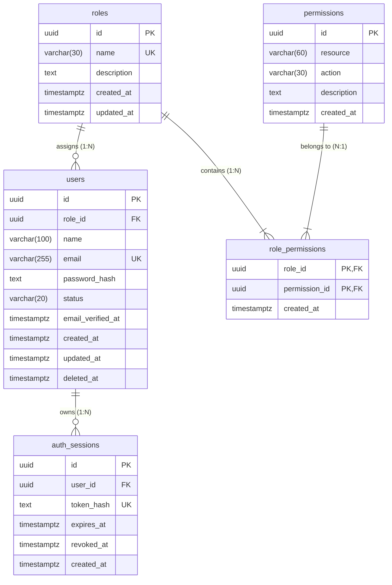

# 03 — Mindora Database Schema Specification

**Database Engine:** PostgreSQL 18.6  
**ORM Tool:** GORM v1.31.2 with `pgx/v5`  
**Host & Port:** `localhost:5433`  
**Database Name:** `mindora`  

---

## 1. Entity-Relationship Diagram (ERD)

---

## 2. Table Specifications

### 2.1 Table: `roles`
- **Purpose:** Persist system authorization roles.
- **Columns:**
  - `id`: `UUID PRIMARY KEY`
  - `name`: `VARCHAR(30) NOT NULL UNIQUE` (Values: `'user'`, `'admin'`)
  - `description`: `TEXT NULL`
  - `created_at`: `TIMESTAMPTZ NOT NULL DEFAULT NOW()`
  - `updated_at`: `TIMESTAMPTZ NOT NULL DEFAULT NOW()`
- **Indexes:**
  - `roles_pkey`: Primary key on `(id)`
  - `idx_roles_name`: B-Tree index on `(name)`
  - `uq_roles_name`: Unique constraint on `(name)`

### 2.2 Table: `permissions`
- **Purpose:** Granular resource-action authorization permissions.
- **Columns:**
  - `id`: `UUID PRIMARY KEY`
  - `resource`: `VARCHAR(60) NOT NULL`
  - `action`: `VARCHAR(30) NOT NULL`
  - `description`: `TEXT NULL`
  - `created_at`: `TIMESTAMPTZ NOT NULL DEFAULT NOW()`
- **Indexes & Constraints:**
  - `permissions_pkey`: Primary key on `(id)`
  - `idx_permissions_resource`: B-Tree index on `(resource)`
  - `uq_permissions_resource_action`: Unique constraint on `(resource, action)`

### 2.3 Table: `role_permissions`
- **Purpose:** Many-to-many junction table between roles and permissions.
- **Columns:**
  - `role_id`: `UUID NOT NULL REFERENCES roles(id) ON DELETE RESTRICT`
  - `permission_id`: `UUID NOT NULL REFERENCES permissions(id) ON DELETE RESTRICT`
  - `created_at`: `TIMESTAMPTZ NOT NULL DEFAULT NOW()`
- **Indexes & Constraints:**
  - `pk_role_permissions`: Composite primary key on `(role_id, permission_id)`
  - `idx_role_permissions_role_id`: B-Tree index on `(role_id)`
  - `idx_role_permissions_permission_id`: B-Tree index on `(permission_id)`
  - `fk_role_permissions_role`: Foreign key to `roles(id)` (`ON DELETE RESTRICT`)
  - `fk_role_permissions_permission`: Foreign key to `permissions(id)` (`ON DELETE RESTRICT`)

### 2.4 Table: `users`
- **Purpose:** Store registered user accounts.
- **Columns:**
  - `id`: `UUID PRIMARY KEY`
  - `role_id`: `UUID NOT NULL REFERENCES roles(id) ON DELETE RESTRICT`
  - `name`: `VARCHAR(100) NOT NULL`
  - `email`: `VARCHAR(255) NOT NULL`
  - `password_hash`: `TEXT NOT NULL` (Never serialized to JSON)
  - `status`: `VARCHAR(20) NOT NULL DEFAULT 'active'`
  - `email_verified_at`: `TIMESTAMPTZ NULL`
  - `created_at`: `TIMESTAMPTZ NOT NULL DEFAULT NOW()`
  - `updated_at`: `TIMESTAMPTZ NOT NULL DEFAULT NOW()`
  - `deleted_at`: `TIMESTAMPTZ NULL` (GORM Soft Delete)
- **Check Constraints:**
  - `chk_users_status`: `CHECK (status IN ('active', 'inactive', 'suspended'))`
- **Email Uniqueness & Soft-Delete Policy:**
  - Enforced via unique functional index: `CREATE UNIQUE INDEX idx_users_email_lower ON users (LOWER(email));`
  - **Policy Decision:** Email addresses remain reserved even after an account is soft-deleted. Re-registering with the same email is rejected to prevent impersonation and maintain academic auditability.
- **Foreign Keys:**
  - `fk_users_role`: References `roles(id)` (`ON DELETE RESTRICT`)

### 2.5 Table: `auth_sessions`
- **Purpose:** Store metadata for refresh tokens, allowing revocation and session tracking.
- **Columns:**
  - `id`: `UUID PRIMARY KEY`
  - `user_id`: `UUID NOT NULL REFERENCES users(id) ON DELETE RESTRICT`
  - `token_hash`: `TEXT NOT NULL UNIQUE` (One-way hash; raw tokens are never stored)
  - `expires_at`: `TIMESTAMPTZ NOT NULL`
  - `revoked_at`: `TIMESTAMPTZ NULL`
  - `created_at`: `TIMESTAMPTZ NOT NULL DEFAULT NOW()`
- **Indexes & Constraints:**
  - `auth_sessions_pkey`: Primary key on `(id)`
  - `uq_auth_sessions_token_hash`: Unique constraint on `(token_hash)`
  - `idx_auth_sessions_user_id`: B-Tree index on `(user_id)`
  - `idx_auth_sessions_expires_at`: B-Tree index on `(expires_at)`
  - `idx_auth_sessions_user_expires`: Composite index on `(user_id, expires_at)`
  - `fk_auth_sessions_user`: Foreign key to `users(id)` (`ON DELETE RESTRICT`)

### 2.6 Table: `schema_migrations`
- **Purpose:** Track version-controlled migration execution history.
- **Columns:**
  - `version`: `BIGINT PRIMARY KEY`
  - `name`: `VARCHAR(255) NOT NULL`
  - `applied_at`: `TIMESTAMPTZ NOT NULL DEFAULT NOW()`
