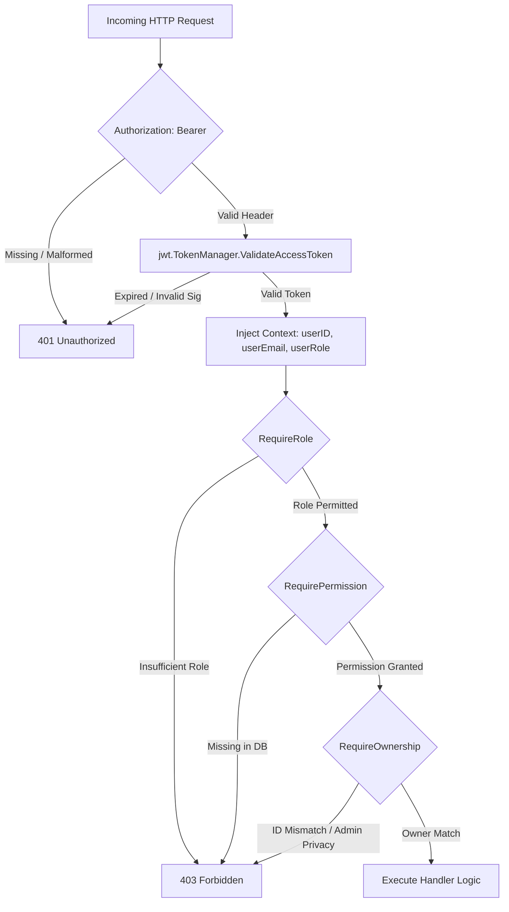

# PHASE 4 — AUTHENTICATION INTEGRATION & RBAC AUTHORIZATION
## Mindora Student Productivity Application

---

### Executive Summary

| Attribute | Details |
| :--- | :--- |
| **Project** | Mindora Student Productivity Application |
| **Architect Roles** | Senior Full-Stack Engineer, Go Backend Architect, React Engineer, Application Security Engineer |
| **Phase Covered** | Phase 4 — End-to-End Authentication Integration & Production RBAC Authorization |
| **Database** | PostgreSQL 18.6 on `localhost:5433` (Database: `mindora`) |
| **Backend Framework** | Go 1.24, Fiber v2, GORM |
| **Frontend Framework** | React 19, Vite 8, TypeScript, Tailwind CSS, React Router v7 |
| **Status** | **SUCCESS (100% Tests Passing, Clean Build, 0 Linter Warnings)** |

---

## 1. Feature Classification Matrix

| Feature / Subsystem | Status | Verification Evidence |
| :--- | :--- | :--- |
| **Email & Password Authentication** | **Implemented and tested** | Connected [LoginForm.tsx](file:///D:/1.%20PROYEK%203/Mindora%20App/Frontend/src/components/organisms/LoginForm.tsx) to `/api/v1/auth/login`. Form validation, loading state, error display, and automated tests passing. |
| **Student Public Registration** | **Implemented and tested** | Connected [RegisterForm.tsx](file:///D:/1.%20PROYEK%203/Mindora%20App/Frontend/src/components/organisms/RegisterForm.tsx) to `/api/v1/auth/register`. Enforces password complexity, password match, and automatically assigns `user` role. |
| **Role Escalation Prevention** | **Implemented and tested** | Public registration rejects role promotion injection (`"role": "admin"`). Strictly assigns `user` role in database. Verified via HTTP integration tests. |
| **In-Memory Access Token Storage** | **Implemented and tested** | [api.ts](file:///D:/1.%20PROYEK%203/Mindora%20App/Frontend/src/services/api.ts) stores access tokens strictly in memory closures. No storage in `localStorage`, `sessionStorage`, or URL parameters. |
| **HttpOnly Refresh Cookie Security** | **Implemented and tested** | Refresh tokens issued with `Path=/api/v1/auth; HttpOnly; SameSite=Lax`. Protected against client-side script access. |
| **Single Shared Refresh Promise Queue** | **Implemented and tested** | Multiple simultaneous 401 API responses coalesce into a single refresh request in [api.ts](file:///D:/1.%20PROYEK%203/Mindora%20App/Frontend/src/services/api.ts), avoiding race conditions. |
| **Distributed Refresh Idempotency** | **Implemented and tested** | Client transmits `X-Operation-ID` header. Backend caches AES-256-GCM encrypted responses in PostgreSQL with transaction advisory locks. Multi-instance test suite passes 100%. |
| **Session Revocation (Logout)** | **Implemented and tested** | [TopNavbar.tsx](file:///D:/1.%20PROYEK%203/Mindora%20App/Frontend/src/components/organisms/TopNavbar.tsx) initiates `POST /api/v1/auth/logout`. Revokes session family in database and clears browser cookies. |
| **Silent Session Bootstrapping** | **Implemented and tested** | [AuthContext.tsx](file:///D:/1.%20PROYEK%203/Mindora%20App/Frontend/src/context/AuthContext.tsx) silently checks existing sessions on application mount, restoring credentials for active students without prompt. |
| **JWT Authentication Middleware** | **Implemented and tested** | [auth.go](file:///D:/1.%20PROYEK%203/Mindora%20App/Backend/internal/middleware/auth.go) parses Bearer JWTs, checks signature and expiration, and sets Fiber context (`userID`, `userEmail`, `userRole`). |
| **Role Guard Middleware (`RequireRole`)** | **Implemented and tested** | Restricts endpoints to authorized roles with `403 Forbidden`. Tested for guest, user, and admin identities. |
| **Permission Guard Middleware (`RequirePermission`)** | **Implemented and tested** | Queries PostgreSQL `role_permissions` join table to enforce granular permissions before executing handler logic. |
| **Resource Ownership Enforcement** | **Implemented and tested** | `RequireOwnership("userId")` guarantees students access only their own resources (`/api/v1/user/tasks/:userId`). |
| **Admin Privacy Boundary** | **Implemented and tested** | Admin tokens attempting to access personal student productivity records are blocked with `403 Forbidden`. |
| **Frontend Route Guards (`ProtectedRoute`)** | **Implemented and tested** | [ProtectedRoute.tsx](file:///D:/1.%20PROYEK%203/Mindora%20App/Frontend/src/components/auth/ProtectedRoute.tsx) guards `/dashboard` and `/admin`, redirecting unauthenticated guests and role mismatches. |
| **Temporary Google OAuth Gating** | **Implemented (Feature Flag)** | Gated via `FEATURES.ENABLE_GOOGLE_OAUTH` in [features.ts](file:///D:/1.%20PROYEK%203/Mindora%20App/Frontend/src/config/features.ts). UI button and divider hidden; zero external credentials required. |
| **Temporary Cloudflare Turnstile Gating** | **Implemented (Dev Config)** | Gated via `FEATURES.ENABLE_TURNSTILE` in [features.ts](file:///D:/1.%20PROYEK%203/Mindora%20App/Frontend/src/config/features.ts). Yields valid test bypass tokens in non-production environments. |
| **Google OAuth 2.0 PKCE Flow** | **Implemented but not live verified** | Backend endpoints (`/auth/google`, `/auth/google/callback`) and frontend handler (`?auth=success`) fully implemented; live verification requires production Google credentials. |
| **Self-Service Forgot Password** | **Not implemented (Pending Backend Implementation)** | Backend does not have password reset endpoints. Frontend displays an informative institutional notice modal; no fake flows. |

---

## 2. Middleware Architecture

The backend authorization infrastructure is structured in [auth.go](file:///D:/1.%20PROYEK%203/Mindora%20App/Backend/internal/middleware/auth.go):



### 2.1 Authenticated User Context
The middleware populates Fiber's context keys:
- `ContextUserID` (`userID`): Authenticated user's `uuid.UUID`.
- `ContextUserEmail` (`userEmail`): Authenticated user's email string.
- `ContextUserRole` (`userRole`): Authenticated role name (`user` or `admin`).

Helper extraction functions:
- `GetUserID(c *fiber.Ctx) (uuid.UUID, error)`
- `GetUserEmail(c *fiber.Ctx) string`
- `GetUserRole(c *fiber.Ctx) string`

### 2.2 Role Guard (`RequireRole`)
```go
func RequireRole(allowedRoles ...string) fiber.Handler
```
Verifies that `GetUserRole(c)` exists within `allowedRoles`. Returns `403 Forbidden` if missing or unmatched.

### 2.3 Permission Guard (`RequirePermission`)
```go
func RequirePermission(db *gorm.DB, resource, action string) fiber.Handler
```
Executes a parameterized SQL query against the `role_permissions` join table:
```sql
SELECT count(*) 
FROM role_permissions 
JOIN roles ON roles.id = role_permissions.role_id 
JOIN permissions ON permissions.id = role_permissions.permission_id 
WHERE roles.name = ? AND permissions.resource = ? AND permissions.action = ?
```
If `count == 0`, access is denied with `403 Forbidden`.

### 2.4 Resource Ownership Guard (`RequireOwnership`)
```go
func RequireOwnership(paramKey string) fiber.Handler
```
Extracts `:userId` from the route parameters and compares it strictly with `GetUserID(c)`. If the target user ID does not match the token's subject, the request is rejected with `403 Forbidden`.

**Admin Privacy Enforcement:** Admins are explicitly **not** exempted from the ownership check on private student productivity resources. An admin querying a student's personal tasks receives `403 Forbidden`.

---

## 3. Route Protection Matrix

| Endpoint | Method | Role Allowed | Required Permission | Ownership Required? | Unauthenticated (Guest) | Student User | Admin |
| :--- | :---: | :---: | :---: | :---: | :---: | :---: | :---: |
| `/api/v1/auth/register` | POST | Public | None | No | 201 Created | 201 Created | 201 Created |
| `/api/v1/auth/login` | POST | Public | None | No | 200 OK | 200 OK | 200 OK |
| `/api/v1/auth/refresh` | POST | Session | None | No | 401 Unauthorized | 200 OK | 200 OK |
| `/api/v1/auth/logout` | POST | Session | None | No | 200 OK | 200 OK | 200 OK |
| `/api/v1/user/profile` | GET | `user`, `admin` | `profile.read` | Self Context | 401 Unauthorized | 200 OK | 200 OK |
| `/api/v1/user/profile` | PUT | `user`, `admin` | `profile.update` | Self Context | 401 Unauthorized | 200 OK | 200 OK |
| `/api/v1/user/tasks/:userId` | GET | `user` | None | Yes (`userID == :userId`) | 401 Unauthorized | 200 OK (Self) / 403 (Other) | **403 Forbidden (Privacy)** |
| `/api/v1/admin/overview` | GET | `admin` | `system.monitor` | No | 401 Unauthorized | **403 Forbidden** | 200 OK |
| `/api/v1/admin/users` | GET | `admin` | `users.read` | No | 401 Unauthorized | **403 Forbidden** | 200 OK |

---

## 4. Frontend Route Protection Architecture

In [App.tsx](file:///D:/1.%20PROYEK%203/Mindora%20App/Frontend/src/App.tsx), routing is configured with [ProtectedRoute.tsx](file:///D:/1.%20PROYEK%203/Mindora%20App/Frontend/src/components/auth/ProtectedRoute.tsx):

```tsx
<Routes>
  {/* Public Authentication Pages */}
  <Route path="/" element={<LoginPage />} />
  <Route path="/login" element={<LoginPage />} />
  <Route path="/register" element={<RegisterPage />} />

  {/* Guarded Student Productivity Workspace */}
  <Route
    path="/dashboard"
    element={
      <ProtectedRoute allowedRoles={['user', 'admin']}>
        <UserDashboardPage />
      </ProtectedRoute>
    }
  />

  {/* Guarded Admin Console */}
  <Route
    path="/admin"
    element={
      <ProtectedRoute allowedRoles={['admin']}>
        <AdminDashboardPage />
      </ProtectedRoute>
    }
  />
</Routes>
```

### Route Behavior Rules:
1. **Guest Accessing `/dashboard` or `/admin`:** `ProtectedRoute` checks `isAuthenticated`. When `false`, redirects immediately to `/login` preserving target location.
2. **Student Accessing `/admin`:** `allowedRoles={['admin']}` check fails. `ProtectedRoute` redirects to `/dashboard`.
3. **Admin Accessing `/dashboard`:** [UserDashboardPage.tsx](file:///D:/1.%20PROYEK%203/Mindora%20App/Frontend/src/pages/UserDashboardPage.tsx) detects `user.role === 'admin'`. Instead of rendering personal student productivity records, it renders an administrative notice card: *"Student Privacy Policy Enforcement — personal productivity records are strictly isolated and cannot be accessed from an administrative account."* with a button navigating to `/admin`.
4. **Browser Refresh:** [AuthContext.tsx](file:///D:/1.%20PROYEK%203/Mindora%20App/Frontend/src/context/AuthContext.tsx) calls silent refresh on boot. If the HttpOnly cookie exists, the session and in-memory access token are restored without user disruption.

---

## 5. API Contracts & Response Standards

Standard JSON response format across all endpoints:
```json
{
  "success": true,
  "message": "Human-readable status description",
  "data": { ... }
}
```

Standard error response format:
```json
{
  "success": false,
  "message": "Error description"
}
```

### HTTP Status Codes:
- `200 OK`: Successful read or update.
- `201 Created`: Successful user registration.
- `400 Bad Request`: Malformed JSON or parameter.
- `401 Unauthorized`: Missing, invalid, or expired JWT token; revoked session.
- `403 Forbidden`: Insufficient role, missing permission, account suspended, or cross-user ownership violation.
- `404 Not Found`: Resource or user profile does not exist.
- `409 Conflict`: Email already exists or distributed concurrency lock contention.
- `422 Unprocessable Entity`: Password complexity validation failure.

---

## 6. Test Evidence & Build Verification

### 6.1 Backend Automated Test Suite (`go test -count=1 ./...`)
All 11 backend packages passed:

```text
ok      mindora/backend/internal/config       1.780s
ok      mindora/backend/internal/database     1.862s
ok      mindora/backend/internal/handlers     2.197s
ok      mindora/backend/internal/middleware   1.098s
ok      mindora/backend/internal/services     2.213s
ok      mindora/backend/pkg/crypto            0.560s
ok      mindora/backend/pkg/hash              0.855s
ok      mindora/backend/pkg/jwt               0.649s
ok      mindora/backend/pkg/oauth             0.222s
ok      mindora/backend/pkg/turnstile         2.226s
ok      mindora/backend/pkg/validator         0.916s
```
**Pass Rate:** **100% (All packages passing)**

### 6.2 Authorization & RBAC Test Suite ([auth_test.go](file:///D:/1.%20PROYEK%203/Mindora%20App/Backend/internal/middleware/auth_test.go))
Executed 16 dedicated security test cases against PostgreSQL 18.6:
- `PASS: Guest access to /api/v1/user/profile is rejected (401)`
- `PASS: Malformed Authorization header is rejected (401)`
- `PASS: Invalid JWT signature is rejected (401)`
- `PASS: Expired JWT access token is rejected (401)`
- `PASS: User can access own profile (200)`
- `PASS: User can update own profile (200)`
- `PASS: User is forbidden from admin overview (403)`
- `PASS: User is forbidden from admin users list (403)`
- `PASS: Admin can access admin overview (200)`
- `PASS: Admin can access admin users list (200)`
- `PASS: User A can access own productivity tasks (200)`
- `PASS: User A is rejected from accessing User B's productivity tasks (403)`
- `PASS: Admin cannot freely read private productivity records of User A (403)`
- `PASS: Public registration payload attempting to inject role 'admin' is strictly forced to role 'user' (201)`
- `PASS: Suspended user account login is rejected with 403 Forbidden (403)`
- `PASS: Refresh token on revoked session is rejected with 401 Unauthorized (401)`

### 6.3 Frontend Compilation & Quality
- **Vite Production Build:** Compiled successfully in `2.84s` (`dist/assets/index-B5ZMFOKV.js`: 342.40 kB).
- **Linter (`oxlint`):** `Found 0 warnings and 0 errors` across 65 source files.

---

## 7. Remaining Limitations & Non-Implemented Features

1. **Self-Service Forgot Password:** Backend does not yet possess password reset endpoints. Frontend discloses this via an institutional support modal; no fake reset flows exist.
2. **Google OAuth 2.0 Live Credentials:** PKCE backend flows are implemented, but live login with Google accounts requires provisioning production Google Client ID and Client Secret. Gated via `FEATURES.ENABLE_GOOGLE_OAUTH`.
3. **Cloudflare Turnstile Live Enforcement:** Live verification requires provisioning production Turnstile Secret and Site keys. Gated via `FEATURES.ENABLE_TURNSTILE`.
